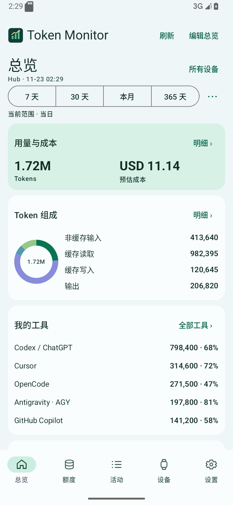
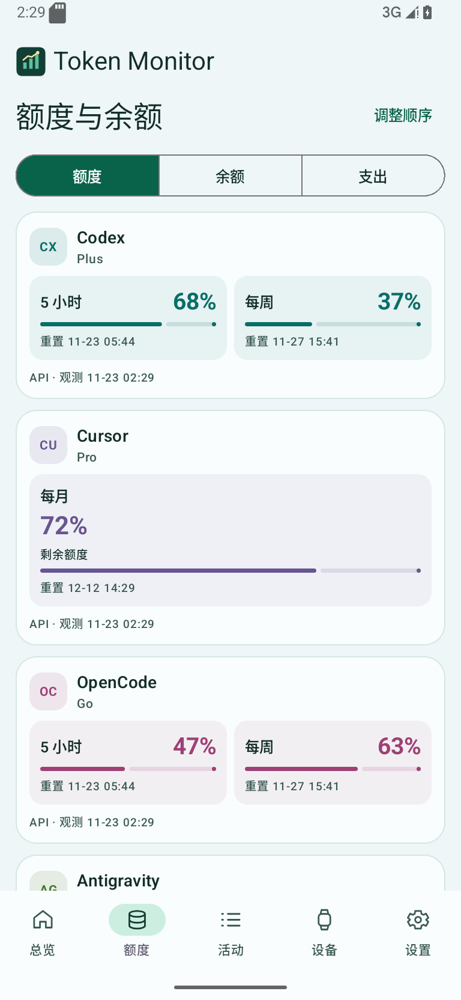
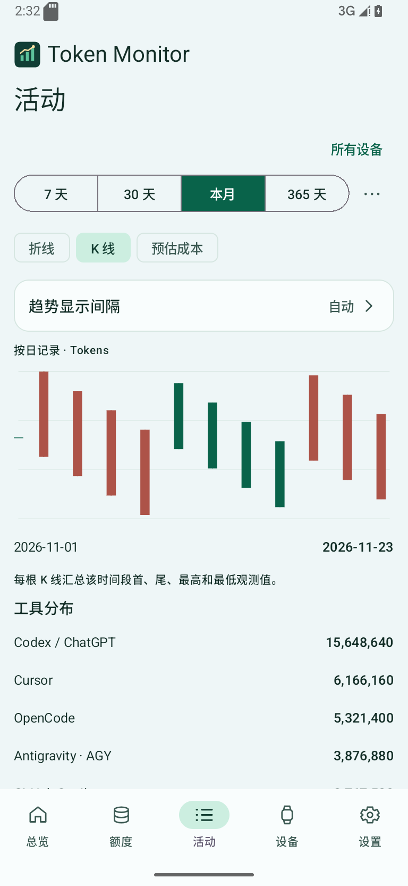
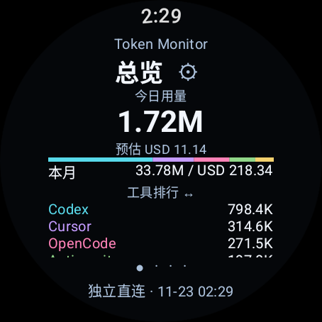
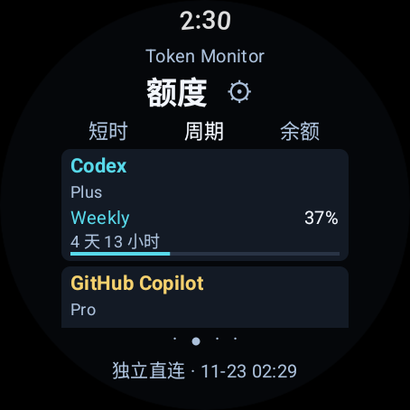

<p align="center">
  
</p>

<h1 align="center">Token Monitor Companion</h1>

<p align="center"><strong>See AI usage, account limits, and balances on Android and Wear OS.</strong></p>

<p align="center">English · <a href="README.zh-CN.md">简体中文</a></p>

<p align="center">
  <a href="https://github.com/JerrySkywalker/token-monitor-companion/releases/latest">Download APKs</a> ·
  <a href="#screenshots">Screenshots</a> ·
  <a href="docs/ACCEPTANCE.md">Acceptance results (Chinese)</a> ·
  <a href="LICENSE">MIT License</a>
</p>

Token Monitor Companion is an open-source client for your existing Token Monitor Hub. The Android app works on its own. The optional Wear OS app can receive usage from the phone or connect to the Hub directly over Wi-Fi or available cellular data. A single Token Monitor Hub serves both apps. [Hub API](https://github.com/Javis603/token-monitor/blob/v0.95.1/docs/API.md#get-apistats)

## Screenshots

| Android overview | Account quotas | Usage trends |
| :---: | :---: | :---: |
|  |  |  |

| Wear OS overview | Wear OS quota groups |
| :---: | :---: |
|  |  |

<p align="center"><sub>Native Android and Wear OS emulator captures from the v0.3.0 source, with synthetic Hub data.</sub></p>

## Features

- **Overview and widgets.** Add, remove, and drag cards in the overview. Pin up to four time filters. Select watched quotas by tool, account, and limit window. Glance home-screen widgets use the same list.
- **Quotas and usage.** View account limits, balances, estimated costs, and reporting devices. Choose standard or compact quota cards and reorder accounts. Inspect line and candlestick charts with separate intraday and daily-history intervals.
- **Watch dashboard.** Swipe through usage, grouped quotas, trends, and reporting devices. Open the dashboard from a Wear OS Tile. Preview and configure watch quota order, time range, chart interval and type, and OLED black from the phone.
- **Appearance and cache.** Choose system, light, dark, or OLED black on Android. The last snapshot stays available when the Hub is temporarily unreachable.

The overview and Activity tab share calendar filters. Intraday charts use observed increments between successful fetches. Longer ranges use the Hub's daily history. Missing observations remain gaps, and display intervals change chart buckets while keeping the existing fetch schedule.

## Quick start

1. Download the `token-monitor-companion-android-v*.apk` for Android 11 or later. For a Wear OS watch, download `token-monitor-companion-wear-os-v*.apk` and install it via wireless debugging. Use `SHA256SUMS.txt` to verify the downloads. [GitHub Releases](https://github.com/JerrySkywalker/token-monitor-companion/releases/latest) · [Wear OS wireless debugging](https://developer.android.com/training/wearables/get-started/debug-wifi)
2. In the phone app, enter your Hub's HTTPS address and Hub Secret, then tap **Connect Hub** (连接 Hub). **Settings → Token Monitor Hub** shows connection status and lets you update the configuration.

Both Release APKs share an application ID and release certificate. Use the same signing channel for in-place upgrades. Switching between Debug and Release requires uninstalling the differently signed build, which clears its local configuration.

## Wear OS setup

| Mode | How the watch gets data |
| --- | --- |
| **Phone push** (手机推送) | The phone fetches the Hub snapshot and sends usage over the Wear OS Data Layer. |
| **Direct** (独立直连) | The watch fetches the HTTPS Hub API using its own connection. |

### Scan the QR code for direct mode

1. Connect the phone and watch to the same Wi-Fi network and make sure they can reach each other.
2. In the watch app, choose **Import Hub from phone** (从手机导入 Hub). If the dashboard is open, use its gear button to reach connection settings.
3. On the phone, open **Settings → Wear OS → Scan watch pairing code** (扫描手表配对码). Scan the watch QR code and tap **Send Hub configuration** (发送 Hub 配置).
4. Wait for **Watch verified the Hub** (手表已验证 Hub). The watch saves the connection and enters direct mode. It can then fetch over its own network. Tap the dashboard timestamp to refresh and check **Local fetch** (本机取数) in connection settings.

The scan uses a two-minute, single-use code and an encrypted local Wi-Fi transfer. Android Keystore protects the saved Hub Secret on each device. A watch-only installation can enter the HTTPS address and Secret under **Configure Hub on watch** (本机配置 Hub).

### Use phone push or update watch display settings

1. Pair the devices in Wear OS system settings and open Token Monitor on both. On the phone, open **Settings → Wear OS** and bind the watch. If the watch is already in direct mode after scanning, enable **Allow phone discovery** (允许手机发现) in its connection settings first.
2. Choose **Phone push** and check the watch's sync acknowledgement (已同步). For later switching to direct mode, send the Hub configuration from the bound watch's settings and select **Direct** after it is verified. Phone push requires the Wear OS Data Layer. [Data Layer overview](https://developer.android.com/training/wearables/data/overview)
3. For a bound watch, use **Display and live preview** (显示与实时预览). To send a display preset to an independent watch, open **Import display settings from phone** (从手机导入显示设置) on the watch and scan from **Standalone watch display preset** (独立手表显示预设) on the phone.

## Build and verify locally

Use JDK 17, Android SDK Platform 36, Build Tools 36.0.0, and Platform Tools. Run from the repository root in PowerShell.

```powershell
.\scripts\local-ci.ps1
.\scripts\local-ci.ps1 -Release
```

Local CI runs Kotlin tests, Lint, and Debug builds for both apps. `-Release` also builds the unsigned Release APKs. Published APKs are signed with the project release certificate. [Emulator validation (Chinese)](docs/AVD.md) · [Acceptance results (Chinese)](docs/ACCEPTANCE.md)

## Acknowledgements and license

Thanks to **Javis603 and the Token Monitor contributors** for the desktop collectors, Hub, and documented API that make this companion possible. See the upstream project for desktop collection and Hub hosting. [Javis603/token-monitor](https://github.com/Javis603/token-monitor)

Thanks to **AoXIUy** for the Android companion reference. [AoXIUy/token-monitor-For-Android](https://github.com/AoXIUy/token-monitor-For-Android)

Token Monitor Companion is licensed under the [MIT License](LICENSE).
