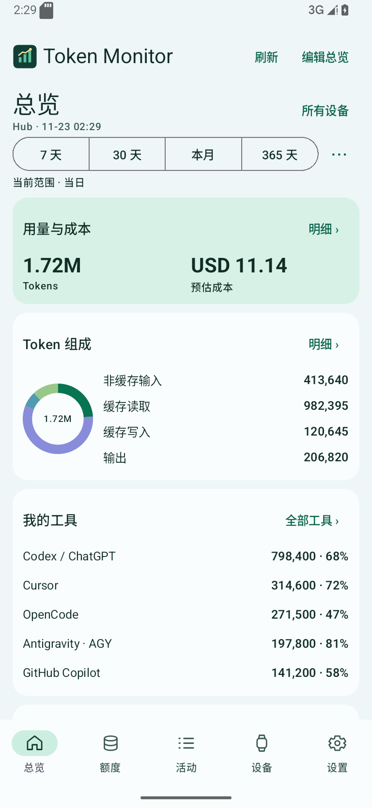
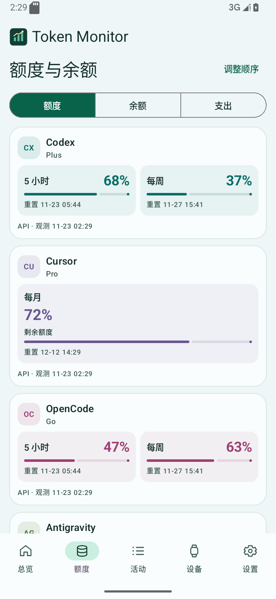
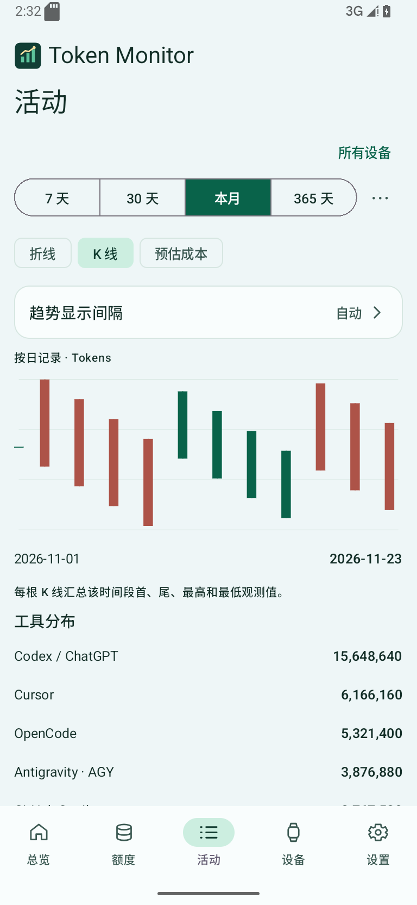
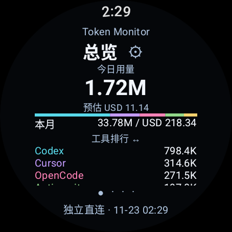
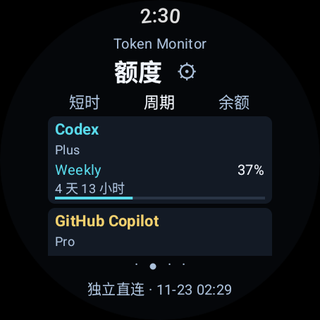

<p align="center">
  
</p>

<h1 align="center">Token Monitor Companion</h1>

<p align="center"><strong>在 Android 手机和 Wear OS 手表上查看 AI 用量、账户额度和余额。</strong></p>

<p align="center"><a href="README.md">English</a> · 简体中文</p>

<p align="center">
  <a href="https://github.com/JerrySkywalker/token-monitor-companion/releases/latest">下载 APK</a> ·
  <a href="#screenshots">截图</a> ·
  <a href="docs/ACCEPTANCE.md">验收记录</a> ·
  <a href="LICENSE">MIT 许可证</a>
</p>

Token Monitor Companion 是现有 Token Monitor Hub 的开源客户端。Android 手机 App 可以独立使用。Wear OS 伴侣可接收手机推送的用量，也可使用手表自己的 Wi-Fi 或蜂窝网络独立直连。两端共用现有 Hub，无需另装 Companion Server。[Hub API](https://github.com/Javis603/token-monitor/blob/v0.95.1/docs/API.md#get-apistats)

<a name="screenshots"></a>

## 截图

| 手机总览 | 账户额度 | 用量趋势 |
| :---: | :---: | :---: |
|  |  |  |

| 手表总览 | 手表额度分组 |
| :---: | :---: |
|  |  |

<p align="center"><sub>截图来自 v0.3.0 源码构建的 Android 和 Wear OS 原生模拟器，使用合成 Hub 数据。</sub></p>

## 主要功能

- **总览和小工具。** 总览卡片可添加、移除和拖动，最多固定四个时间筛选。关注额度可精确选到工具、账号和限制窗口，支持已用或剩余口径，以及纯文字或带数据条样式。Glance 桌面小工具共用这些设置。
- **额度和订阅。** 点开账户卡片查看剩余走势和近 14 天的每日观测用量。Hub 提供共享订阅记录时，可查看套餐、金额和续费信息。额度页支持标准、紧凑布局和账户排序。
- **活动和设备。** 支持折线和 K 线，可查看日历范围以及过去 1、2、4、8、12 小时。工具分布带 Tokens 占比数据条。采集设备可单独设置布局和排序。
- **手表看板。** 横滑查看用量、分组额度、趋势和设备。支持从 Wear OS Tile 打开。在手机实时预览并设置手表的额度顺序、趋势范围、间隔、图表类型和 OLED 纯黑。
- **外观和缓存。** 手机端支持跟随系统、浅色、深色和 OLED 纯黑。手机与手表预设均可选择 K 线的涨跌颜色。Hub 暂不可达时仍可查看最近的快照。

总览和活动页共用日历时间筛选。日内曲线根据成功取数之间的观测增量绘制，较长范围使用 Hub 日历史。显示间隔调整图表分桶，取数频率沿用现有同步方式。额度历史从手机首次成功观测起累积，没有可比较观测的日期留空。

## 快速开始

1. Android 11 或以上的手机安装 `token-monitor-companion-android-v*.apk`。Wear OS 手表下载 `token-monitor-companion-wear-os-v*.apk`，可通过无线调试安装。下载后用 `SHA256SUMS.txt` 核对文件。[GitHub Releases](https://github.com/JerrySkywalker/token-monitor-companion/releases/latest) · [Wear OS 无线调试](https://developer.android.com/training/wearables/get-started/debug-wifi)
2. 打开手机 App，填写 Hub 的 HTTPS 地址和 Hub Secret，点「连接 Hub」。「设置 → Token Monitor Hub」可检查连接并编辑配置。

两端 Release APK 使用相同应用 ID 和发布证书。同签名版本可以覆盖升级。Debug 和 Release 签名不同，切换安装渠道需要卸载原版本，原版本的本地配置会随卸载清除。

手机端可在「设置 → 总览布局」中选择「普通」或「紧凑」。切换后保留原有卡片与排列顺序。

## Wear OS 使用方式

| 模式 | 数据来源 |
| --- | --- |
| **手机推送** | 手机从 Hub 取数，经 Wear OS Data Layer 把用量同步到手表。 |
| **独立直连** | 手表通过自己的网络访问 Hub 的 HTTPS API。 |

### 扫码导入并启用独立直连

1. 让手机和手表连到可以相互访问的同一 Wi-Fi。
2. 在手表打开「设置 → 连接与同步 → 从手机导入 Hub」。看板上的齿轮可进入设置。
3. 在手机「设置 → Wear OS → 扫描手表配对码」扫描表上的二维码，再点「发送 Hub 配置」。
4. 等待手机显示「手表已验证 Hub」。配置保存后，手表进入独立直连。点击看板底部时间可手动刷新，在齿轮中查看「本机取数」。

配对码有效期两分钟，使用一次即失效。Hub 配置通过局域网加密传输，两端使用 Android Keystore 保护保存的 Hub Secret。只安装手表 App 时，可在「本机配置 Hub」直接输入 HTTPS 地址和 Secret。

### 手机推送与手表显示设置

1. 先在系统中配对手机和手表，再打开两端 App。在手机「设置 → Wear OS」发现并绑定手表。已通过扫码进入独立直连的手表需先在连接页点「允许手机发现」。
2. 在手机的手表设置中选择「手机推送」，以「已同步」回执确认用量送达。要切换到独立直连，可先在同一设置页下发 Hub 配置，验证后切换到「独立直连」。手机推送依赖 Wear OS Data Layer。[Data Layer 文档](https://developer.android.com/training/wearables/data/overview)
3. 已绑定手表可在「显示与实时预览」设置显示。独立手表打开「显示设置 → 从手机导入显示设置」，再从手机「独立手表显示预设」扫码下发。

手机和独立直连的手表在前台监听 Hub 更新，数据到达后刷新。手机推送模式由 Wear OS 数据事件触发手表刷新。Hub 不提供事件流时，前台仍会定时取数，后台继续按系统调度刷新。

## 本地构建与验收

使用 JDK 17、Android SDK Platform 36、Build Tools 36.0.0 和 Platform Tools。在仓库根目录运行 PowerShell。

```powershell
.\scripts\local-ci.ps1
.\scripts\local-ci.ps1 -Release
```

本地 CI 运行 Kotlin 测试、两端 Lint 和 Debug 构建。`-Release` 还会构建未签名的 Release APK。发布页文件以项目发布证书签名。[模拟器验收方法](docs/AVD.md) · [验收记录](docs/ACCEPTANCE.md)

## 致谢与许可

感谢 **Javis603 和 Token Monitor 的贡献者**提供桌面采集、Hub 及 API 文档，让手机和手表能够接入同一份用量数据。桌面采集和 Hub 部署请参阅上游项目。[Javis603/token-monitor](https://github.com/Javis603/token-monitor)

感谢 **AoXIUy** 提供 Android 客户端的参考。[AoXIUy/token-monitor-For-Android](https://github.com/AoXIUy/token-monitor-For-Android)

本项目采用 [MIT 许可证](LICENSE)。
